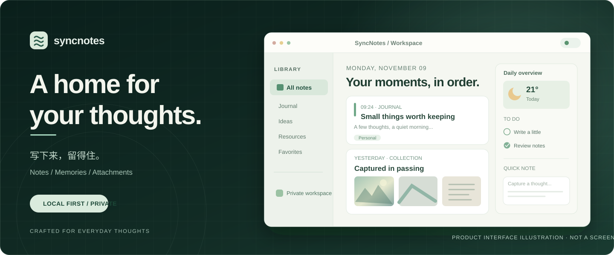

<div align="center">



<br />

### 留住想法，也留住生活。

本地优先的个人记录空间。把随手写下的文字、日常片段与附件，整理成属于自己的时间线。

<p>
  <a href="https://github.com/1463503175-pixel/syncnotes-web/releases/tag/v1.1.7"><strong>Download for Windows</strong></a>
  &nbsp; · &nbsp;
  <a href="docs/GETTING_STARTED.md"><strong>快速开始</strong></a>
  &nbsp; · &nbsp;
  <a href="public/index.html"><strong>Explore the UI</strong></a>
</p>

<sub>LOCAL FIRST &nbsp; / &nbsp; RICH NOTES &nbsp; / &nbsp; ATTACHMENTS &nbsp; / &nbsp; OPTIONAL AI</sub>

</div>

---

## Your space, your stories.

**SyncNotes** 是一个以本地数据为核心的个人记事本项目。它不只保存单条文字：你可以沿时间线回看记录，管理图片、音频和文档等附件，并按自己的习惯组织日常内容。

仓库包含 **Node.js 网页服务、原生 HTML/CSS/JavaScript 界面、同步接口及本地工具**。Windows 桌面版另以 GitHub Release 发布；它与当前 main 分支源码可能不完全一致。

## Made for everyday moments

| | |
|---|---|
| **01 · Capture everything** | **随时记录，不限于文字。** 写下日记、灵感和备忘，为记录关联图片、声音和文件，让内容与上下文留在一起。 |
| **02 · Find your rhythm** | **让记录成为可浏览的时间线。** 多列工作台、日期与内容视图、附件预览，帮助你从零散笔记中找到过去的思路。 |
| **03 · Own your data** | **数据留在自己选择的设备与目录。** 网页服务使用本地文件存储；提供同步接口与可选 AI 配置，是否连接外部服务由使用者决定。 |

> 首页上方展示的是根据当前网页布局绘制的 **产品概念插画，并非实际运行截图**。图中内容为示例，不代表用户真实数据。

## Start writing

### Option A — Windows desktop

想直接使用 Windows 桌面程序，可下载历史正式打包版本：

**[Windows v1.1.7 · Download release](https://github.com/1463503175-pixel/syncnotes-web/releases/tag/v1.1.7)**

发布页提供 `Chen-Dushan-Notes-1.1.7-Windows.zip`。解压并按 [桌面版使用说明](releases/1.1.7/Chen-Dushan-Notes-EXE-使用说明.md) 完成首次本地账号与数据路径设置。

### Option B — Run the web source

如果希望运行和修改当前网页源码，准备好 Node.js：

```bash
git clone https://github.com/1463503175-pixel/syncnotes-web.git
cd syncnotes-web
node server.js
```

浏览器访问 **http://localhost:8765**。

> [!IMPORTANT]
> 当前源码默认使用 Windows 的 `E:\SyncNotes\web\data` 和 `E:\SyncNotes\web\attachments`。换电脑运行时，请先按 [快速上手指南](docs/GETTING_STARTED.md) 配置自己的数据路径，避免默认路径不可用。

[**Read the getting started guide →**](docs/GETTING_STARTED.md)

## Under the hood

```text
SyncNotes
├── public/index.html              Web UI · HTML / CSS / JavaScript
├── server.js                      Node.js · local web server & APIs
├── tools/                         Attachment text extraction
├── scripts/                       Windows development start scripts
├── migrate-*.js                   Legacy data migration helpers
├── docs/                          Guides & design notes
└── releases/                      Desktop release documentation
```

<details>
<summary><strong>AI, attachments & device synchronization</strong></summary>

- **AI 是可选的。** 可以通过自己的 API 地址、密钥与模型配置启用相关能力；仓库不提供现成的公共密钥。
- **附件在本地存放。** 图片、音视频和文档处理能力依赖当前代码与可用的本机工具；部分格式可能需要 FFmpeg 或 Python。
- **同步能力需配套客户端。** 本项目含服务端同步接口，但当前仓库不等于包含完整 Android 安装包或开箱即用的公网同步服务。跨设备访问需要额外配置网络与客户端。

</details>

<details>
<summary><strong>Local data, privacy & backups</strong></summary>

笔记和草稿位于数据目录，图片及其他附件位于附件目录。含有账号信息、个人内容或 API Key 的文件**不应提交到公开仓库**。

请定期备份数据目录及附件目录。网页服务不应在未经认证和安全配置核查的情况下直接暴露在公网；`local-first` 不等于默认具备公网安全防护。

</details>

---

<div align="center">

**Your notes are yours to keep.**

<sub>Web source on `main` · Windows package: v1.1.7 · <a href="LICENSE">MIT License</a></sub>

<br />

<sub><a href="docs/GETTING_STARTED.md">Documentation</a> · <a href="https://github.com/1463503175-pixel/syncnotes-web/releases">Releases</a> · <a href="https://github.com/1463503175-pixel/syncnotes-web/commits/main/">Changelog</a></sub>

</div>
